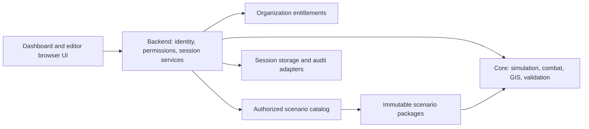

# CDC Sim commercial repository migration plan

Status: future commercial migration plan, updated 2026-09-17. The current GitHub release remains free to download under its existing GPLv3 license. Scenario packaging, explicit content/data configuration, private-beta diagnostics and backup boundaries, and a local Windows release workflow are implemented. The physical `core/backend/frontend/editor` source move, identity, entitlements, managed hosting, and customer deployment remain staged work.

Follow-up reports: [existing file ownership](repository-file-map.md), [license and IP risks](../commercial/license-ip-risk-report.md), [licensing-ready production architecture](licensing-ready-architecture.md), and the [private-beta runtime decision](adr-0001-private-beta-runtime.md).

Assessment date: 2026-09-04. Source baseline: commit `3bb8c01` (`feat: expand combat, installations, and campaign systems`). The working tree was clean at the start of inspection.

## 1. Recommendation

Keep the existing Python simulation, Flask service, browser interface, and JSON scenario format. Evolve them into a private modular monolith with independently distributed scenario packages. The current private-beta path is a signed per-user Windows installation with one loopback server process and versioned customer storage per scenario. Retain the chair-operated experience while the later vendor-managed organization service adds identity, tenant isolation, and one isolated engine process per committee.

The first migration should establish configuration and package boundaries, then move existing modules with their behavior intact. Splitting combat algorithms, introducing a new frontend framework, and building shared multi-tenant infrastructure are later decisions, not prerequisites for this structure.

The immediate commercial requirements need three separate controls:

1. Private source hosting and private release pipelines control future source exposure.
2. Server-side authentication, authorization, and deployment isolation control product access.
3. Content packaging and server-side entitlements control which scenarios an organization can use.

A directory named `core`, an executable, or a license-key field does not provide these controls by itself.

## 2. What is actually in this checkout

| Component | Observed implementation | Migration implication |
| --- | --- | --- |
| Simulation orchestration | `engine.py`: `SimulationEngine`, timeline, combat, detection, diplomacy, missions, political control, installations, persistence | Move intact first. Preserve locks, timing, combat outcomes, and restore behavior. |
| Unit model and behavior | `app.py`: `MilitaryUnit`, movement/readiness/combat helpers; this is not the Flask application | Give it an unambiguous name such as `units.py` in the core package. |
| Core doctrine | `doctrine.py`: canonical orders and stances | Keep authoritative doctrine in core; scenario rules must not override it. |
| Military installations | `installations.py`: installation model | Move to core without replacing the model. |
| GIS | `gis.py`: raster/vector handling, terrain, routing, provinces | Preserve the existing optional-data fallbacks and numerical behavior. |
| Scenario loading | `dlc_loader.py`: `DLCPackage`, validation, safe path resolution, discovery, doctrine composition | Reuse this boundary; separate configured content discovery from validation gradually. |
| Backend | `server.py`: Flask pages and APIs, module-global engine and physics thread | Introduce an application factory and explicit session lifecycle; do not enable multiple WSGI workers against this state. |
| Dashboard | `templates/index.html`, `static/js/tactical_engine.js`, `static/css/style.css` | Browser JavaScript primarily presents state and issues commands, with client-side estimates. Preserve authoritative simulation in Python. |
| Editor | `templates/cdc_editor.html`: inline UI/validation/export logic; `/api/editor_template` in `server.py` | Separate editor assets and backend routes, while retaining shared server-side validation. |
| GIS authoring utility | `dem_scanner.py`: local analysis, plotting, optional DEM download | Place in editor tooling; separate its authoring dependencies from the runtime where practical. |
| Scenarios | Tracked `dlc/_template` and `dlc/test`; `test` describes itself as a synthetic systems-testing sandbox | Preserve the template and test sandbox. Do not silently label the test sandbox a finished official campaign. |
| Intentionally excluded content | `dlc/afghan/` is ignored by Git and present locally during assessment | Leave it excluded. Do not restore it to version control or add it to release artifacts. |
| Tests | `tests/test_regressions.py`: engine, API, loader/GIS, and frontend checks | Keep these as the migration baseline; adjust imports and asset paths when modules move. |
| Installation | Source batch launchers plus `deployment/windows` PyInstaller/Inno Setup workflow | Keep the batch files for developers; distribute only a signed and validated installer to testers. |
| Documentation | English/Chinese root manuals and HTML chair guides | Move detailed source manuals into docs with compatibility links; continue serving guides at their existing URLs. |
| License | Root `LICENSE` contains GPLv3 | Resolve rights for future proprietary releases before replacing licensing notices or distributing a proprietary build. |

There is no separate AI subsystem to move as a unit today. Existing automated detection and routing stay with their current modules until a specific extraction is justified.

### Verification performed

- Inspected tracked paths, local content directories, Python imports and implementation sections, routes, scenario metadata, browser/editor integration, launchers, license, and regression tests.
- The initial 2026-09-04 baseline ran 89 tests on Python 3.12.14. After the productization changes, the local application suite runs **140 tests with 0 failures and 1 expected Windows symlink-privilege skip**.
- The separate Windows release-policy suite runs **5 tests with 0 failures**. JavaScript syntax checks and the scenario-authoring Node test pass; the beta source policy reports no external executable browser assets and selects only `_template` and `test`.
- A local PyInstaller QA bundle passed its frozen route, GIS import, scenario mount, checkpoint, backup export, and backup import self-test. No signed Inno installer, clean-machine acceptance run, malware scan, dependency vulnerability scan, or legal copyright clearance has been completed.
- Verification excludes the intentionally omitted local content. The release configuration explicitly rejects it, and the test fixtures use `_template`, `test`, and temporary synthetic packages.
- Read-only checks on 2026-09-12 confirmed both configured GitHub remotes exist for authenticated access and return 404 to unauthenticated API requests, so neither was publicly readable through GitHub at check time. No visibility change, commit, push, release, or upload was performed. These results are engineering evidence, not a production security certification or distribution-rights determination.

### Existing strengths to retain

The loader rejects invalid packages before mounting, resolves configured paths within the scenario directory, validates finite numeric inputs, and keeps authored scenario rules distinct from core doctrine. Engines already receive isolated copies of registries and rules, and `SimulationEngine` already accepts both `package` and `storage_dir`. Saves use JSON, temporary files, flushing, and atomic replacement. These are useful seams for migration.

Preserve manual checkpoints, restore-to-paused behavior, save compatibility, detection-based route avoidance, GIS fallback behavior, chair adjudication, and the existing separation of tactical task from combat stance.

## 3. Commercial constraints found in the code

### Source rights and visibility

The existing GPLv3 grant cannot be withdrawn from compliant recipients simply by changing the repository visibility or replacing `LICENSE`; see section 2 of the [existing license](../../LICENSE). Future proprietary licensing needs documented ownership or sufficient permission for all included contributions and dependencies. Copyright holders can offer their code under multiple non-exclusive licenses, subject to rights they actually hold. Confirm contributor, employer/school, and third-party rights before a proprietary release. See the [GNU licensing FAQ](https://www.gnu.org/licenses/gpl-faq.en.html#ReleaseUnderGPLAndNF).

GPLv3 distinguishes network interaction from conveying a copy; inspect sections 0 and 6 of the existing license when assessing hosted service versus distributed enterprise builds. Browser-delivered code and third-party components need their own distribution review. A hosted beta does not settle all licensing questions for later customer-hosted releases.

Make future development and build artifacts private after verifying the actual remote and current access. If hosted on GitHub, changing the repository to private leaves existing public forks public; [GitHub documents this behavior](https://docs.github.com/en/repositories/managing-your-repositorys-settings-and-features/managing-repository-settings/setting-repository-visibility). Previously downloaded copies cannot be recalled. Audit public releases, registries, documentation hosting, and CI artifacts separately. `.gitignore` only affects tracking behavior; it is not access control.

Keep customer scenarios in separate private content repositories or storage with their own access rules. The proposed customer directory is a local development/staging convention, not a reason to commit every customer's material into the product repository.

### Access and data exposure

- The API currently has no authentication or role checks. Routes such as `/api/mount_dlc`, `/api/command`, `/api/admin_edit`, `/api/load_game`, and `/api/reset_scenario` are reachable by any client that can reach the service.
- `/api/state` serializes all units; `/api/registry` returns active registries and rules. Scenario metadata describing delegate visibility is not access enforcement. A delegate view requires server-side filtering, including records, logs, exports, and caches.
- `/api/health` exposes local path/environment details. Separate a minimal health endpoint from authenticated operational diagnostics.
- The editor contains HTML construction and inline event handlers. Review scenario-controlled strings in HTML, attributes, and JavaScript contexts before allowing untrusted content; client validation is not a security boundary.

The current default bind is `127.0.0.1` and debug is disabled. That is appropriate evidence of local-first operation, not a substitute for authentication when exposed over a network.

### Runtime and persistence

- `server.py` owns one global engine and physics thread. Multiple workers would have independent engine state; more than one customer routed to this process would share the active committee.
- The engine has instance-specific registries, but `app.py` retains legacy global registry fallbacks. Make explicit injection mandatory before supporting multiple sessions in one interpreter.
- Direct engine use still defaults saves to the project directory for compatibility. The server now supplies a per-user session directory, namespaced by package ID/version for versioned packs or folder ID for legacy content.
- Save format is currently **4**, with readers accepting **1-4**; rules schema is **1**. Package manifest schema 1 records package identity, compatibility, canonical documents, capabilities, and build-generated content hashes.
- Saves still record a runtime scenario-folder ID and rules schema, rather than the immutable package version/digest. Updating or renaming content can therefore make an old checkpoint ambiguous.
- Randomness uses the Python `random` module across engine/unit code. Use explicit seeds or controlled randomness for comparison tests; introduce a session-owned random generator only as a separately verified change.

### Build and operating experience

- The root source launcher intentionally keeps Flask's development server for contributors. The packaged Windows launcher uses one Waitress process, loopback binding, readiness polling, and a duplicate-instance mutex.
- The source setup script now enforces Python 3.12 and stops on failed environment, install, or dependency checks. Private-beta testers use the separate packaged installer and never run this script.
- `build_info.json` and `deployment/windows` provide release metadata, an explicit source/content allowlist, PyInstaller/Inno Setup assembly, artifact hashing, signing gates, and self-tests. A private CI job, full transitive hash lock, final notices/SBOM, and container workflow remain future release work.
- Leaflet and JSZip are bundled locally with hashes and notices. The generated Clean basemap is local; optional Topo/Admin imagery still creates a provider/network dependency and must match each release profile.

## 4. Target repository

This tree describes the target. Only create subdirectories when their contents move or are implemented. Python package names are explicit; business directories do not need to become separate deployable services.

```text
cdc-sim/
├── pyproject.toml                  # Private product build and development configuration
├── README.md                      # Product/developer entry point
├── README_zh.md                    # Chinese entry point
├── LICENSE                        # Existing notices; future changes depend on rights review
├── core/
│   └── cdc_sim_core/
│       ├── __init__.py
│       ├── engine.py              # Existing SimulationEngine, moved intact initially
│       ├── units.py               # Existing app.py / MilitaryUnit
│       ├── doctrine.py
│       ├── installations.py
│       ├── gis.py
│       └── scenario_loader.py     # Existing validation and DLCPackage contract
├── scenarios/
│   ├── official/                  # Versioned, redistributable first-party source packages
│   ├── customers/                 # Policy README; actual customer payloads excluded
│   ├── templates/
│   │   └── starter/               # Existing _template data
│   └── schemas/                   # Versioned package format and authoring documentation
├── editor/
│   ├── templates/cdc_editor.html
│   ├── static/                    # Extract existing inline code incrementally
│   └── tools/dem_scanner.py
├── backend/
│   └── cdc_sim_backend/
│       ├── __init__.py
│       ├── app.py                 # create_app(settings, services)
│       ├── settings.py            # Content roots, data root, deployment mode
│       ├── routes/                # Pages, simulation, editor, operations
│       ├── services/              # Session lifecycle and content access
│       ├── storage/               # Session/checkpoint adapters
│       ├── auth/                  # Identity and role enforcement, introduced for beta
│       └── licensing/             # Entitlement boundary, introduced when needed
├── frontend/
│   ├── templates/                # index, status, served chair guides
│   └── static/
│       ├── css/style.css
│       └── js/tactical_engine.js
├── docs/
│   ├── architecture/
│   ├── user/                     # English and Chinese detailed manuals
│   ├── scenarios/                # Authoring and compatibility contracts
│   └── operations/               # Installation, upgrades, backup, support
├── tests/
│   ├── test_regressions.py        # Retained during initial moves
│   ├── fixtures/scenarios/        # Existing synthetic test package
│   ├── core/                     # Split by behavior when useful
│   ├── backend/
│   └── acceptance/                # Installed product and key user journeys
└── deployment/
    ├── windows/                  # Supported launch/install tooling
    ├── container/                # Explicit runtime build context and server startup
    ├── profiles/                 # Development, beta, organization configurations
    └── release/                  # Packaging, verification, notices, release metadata
```

Retain the two root Windows batch files as small forwarding launchers for continuity. Retain a root `server.py` launcher temporarily if needed by existing workflows. The folder on a user's machine does not need to be renamed for the migration.

Start with one root build configuration and explicit package/asset inclusion. Package the two uniquely named Python packages and the UI resources into an internal product artifact. Do not rely on running from the repository root or copying the whole checkout. Separate distributions for core and backend can wait until independent release lifecycles justify them.

### Concrete move map

| Current path | Target path | Required companion change |
| --- | --- | --- |
| `app.py` | `core/cdc_sim_core/units.py` | Update engine/server/tests imports; preserve injected registries. |
| `engine.py` | `core/cdc_sim_core/engine.py` | Replace root imports and remove repository-root defaults through configuration. |
| `doctrine.py` | `core/cdc_sim_core/doctrine.py` | Update loader import; retain doctrine merge/override validation. |
| `installations.py` | `core/cdc_sim_core/installations.py` | Update core/test imports. |
| `gis.py` | `core/cdc_sim_core/gis.py` | Retain public behavior and optional native-library handling. |
| `dlc_loader.py` | `core/cdc_sim_core/scenario_loader.py` | Explicit content-root/package-directory input; preserve legacy IDs via a catalog adapter. |
| `server.py` | `backend/cdc_sim_backend/app.py`, then routes/services | First preserve routes; extract responsibilities in subsequent changes. |
| Dashboard/status/guide templates | `frontend/templates/` | Configure template resolution and packaged resources; keep current page URLs. |
| `static/` | `frontend/static/` | Preserve `/static/...` URLs initially; update asset-location tests. |
| `templates/cdc_editor.html` | `editor/templates/cdc_editor.html` | Configure editor template lookup; retain `/editor` and template API. |
| `dem_scanner.py` | `editor/tools/dem_scanner.py` | Document authoring entry point and optional dependencies. |
| `dlc/_template/` | `scenarios/templates/starter/` | Map legacy `_template` ID and keep templates out of the playable catalog. |
| `dlc/test/` | `tests/fixtures/scenarios/full-spectrum/` | Inject fixture root in tests; optionally expose it in the developer profile only. |
| `dlc/afghan/` | External/private content location when its owner chooses | Excluded intentionally; no tracking or forced relocation. |
| Root detailed manuals | `docs/user/` | Preserve entry links and relative images/links; synchronize release instructions. |
| Root batch implementations | `deployment/windows/` | Preserve root launchers; resolve paths from script location and fail on setup errors. |
| Root logs/checkpoints | Configured runtime data directory | Copy and validate through a migration command; do not move them as source files. |

## 5. Dependency and ownership boundaries



Core imports neither Flask nor frontend/editor code, and does not consult billing, authentication, customer IDs, or license servers. It consumes validated scenario data and explicit runtime dependencies. Backend owns identity, authorization, configured file access, session lifecycle, and commercial policy. During migration the existing engine may continue writing saves through its injected `storage_dir`; extracting a storage interface is a subsequent refactor.

Keep numerical combat and movement algorithms in core. Scenario rules contain approved parameters and scenario-specific data, not arbitrary Python/JavaScript code or overrides of canonical orders/stances. If a customer needs a new mechanic, implement a tested general capability in core and configure it in content; avoid customer branches of engine code.

The browser can receive authorized display data and command descriptions. It necessarily exposes downloaded JavaScript and received data. Review `/api/registry` and editor responses to send only what the user's role and screen require. Minification and absent source maps reduce incidental disclosure but cannot hide browser-delivered logic.

## 6. Scenario packages and customer separation

Keep the existing five JSON files and optional GIS assets as the payload. Introduce a small `manifest.json` alongside them, with a distinct manifest schema version; do not change the rules schema just to add commercial metadata.

The manifest should identify a stable package ID, publisher, package version, compatible engine range, rules schema version, entry files, and asset hashes. Release metadata should record redistribution rights for maps, imagery, briefings, and other assets. Free versus paid is a catalog/entitlement decision; an editable `paid: true` or `organization_id` in customer-authored JSON must not grant access.

Use these separate identities:

| Identity | Purpose |
| --- | --- |
| Package ID and immutable version/digest | Identifies exact content and prevents unnoticed replacement. |
| Organization ID | Assigned by trusted account/deployment configuration. |
| Session ID | Identifies one committee run, independent of scenario ID. |
| User ID and role | Determines permitted actions and visible state. |

Suggested runtime locations, all outside source and served static directories:

```text
<content-root>/official/<package-id>/<version>/
<content-root>/customers/<organization-id>/<package-id>/<version>/
<data-root>/organizations/<organization-id>/sessions/<session-id>/checkpoints/
<data-root>/organizations/<organization-id>/sessions/<session-id>/logs/
```

For the first beta, mount only one organization's permitted content into its deployment and use separate data volumes. Folder naming alone provides no isolation. The backend must authorize listing, mounting, downloading, exporting, saving, and restoring. Derive organization membership from trusted identity/configuration; never accept a request's organization ID as proof of membership.

Official/paid packages can be signed in the release pipeline and verified before installation. Customer drafts follow an explicit organization authoring policy and remain untrusted data. Never distribute signing private keys. A signature proves provenance/integrity, not ownership, entitlement, confidentiality, or safety.

Package import should validate identifiers, JSON schema, reference consistency, numerical/resource limits, hashes, archive size/entry count, and resolved paths before activation. Reject archive traversal, absolute paths, links escaping the package, duplicate entries, and executable hooks. Install into a staging directory and atomically activate an immutable version after validation. Extend the existing loader rather than bypassing it.

Compatibility policy:

- Keep a catalog adapter for legacy `dlc/<id>` packages and `_template` during a defined transition period. Legacy content still requires server-side authorization.
- Resolve a single explicit ID/version; reject ambiguous IDs across roots rather than silently selecting customer or official content.
- Extend saves to bind the exact package version/digest in a separately versioned format change. Keep existing readers for formats 1–4 while supported.
- Import legacy checkpoints by inspecting their metadata. For files without scenario identity, require an explicit association; do not guess based on the filename.
- Do not overwrite authored starting scenarios or mutate installed content during a session. Keep customer variants as independent packages with documented origins.

## 7. Beta, builds, and licensing architecture

### Private beta

Use invited named chair accounts with organization membership. Keep delegate access out of the first beta unless the server-side visibility model is implemented and tested. Protect the entire application and API, including editor routes, content discovery, registries, reports, diagnostics, and all mutating requests.

The beta deployment needs TLS, server-side role checks, secure sessions, CSRF protection for cookie-authenticated mutations, request limits, audited administrative actions, and revocation of invited users. If authentication terminates at a proxy, prevent direct backend access and trust identity headers only from that proxy. Keep secrets and identity configuration outside scenarios and source control.

Use a production WSGI server in **one process per committee**. Waitress is a candidate for the Windows deployment path and supports Windows directly; see [Flask's Waitress guidance](https://flask.palletsprojects.com/en/stable/deploying/waitress/). Own exactly one timeline thread, stop/join it on session replacement and shutdown, serialize mutations, and define startup/readiness behavior. A second worker or automatic second replica must not silently create another clock for the same committee.

For more concurrent committees, launch additional isolated processes/deployments first. A shared session registry and dedicated simulation workers can follow demonstrated demand. Introducing queues, Kubernetes, or a shared database solely to reorganize folders adds cost before it solves a current need.

Keep three manual checkpoints and pause-on-restore behavior. Back up the session volume with a documented restore procedure, record release IDs in support diagnostics, and rehearse restart recovery before each beta release. Persist an actor/action audit separate from the gameplay log.

### Commercial release profiles

| Profile | Code and assets | Content | Access policy |
| --- | --- | --- | --- |
| Development | Source checkout, editor, synthetic fixtures | Explicit developer content roots | Local development configuration |
| Private beta | Private server artifact plus browser assets | Approved evaluation packages only | Invited chairs, one organization per deployment |
| Organization hosted | Same product artifact, configured per organization | Entitled official and customer packages | Organization roles and entitlements |
| Customer hosted | Supported runtime/container or installer, after distribution-rights review | Separately delivered authorized packages | Organization identity plus online or signed offline entitlement |

Produce server artifacts, scenario archives, and browser assets separately. Use an explicit build allowlist; exclude `.git`, `.venv`, tests, customer payloads, checkpoints, logs, secrets, and internal documentation. Include required license notices. Never publish the internal Python wheel or container to a public registry by default. Do not use the entire checkout as a public web root or an unrestricted container build context.

Lock the full dependency graph and build tooling for a supported Python/OS matrix, inventory native GIS dependencies, scan release artifacts, and record a build ID and software bill of materials. Verify installed artifacts outside the checkout so missing templates or accidental relative imports are caught. Preserve the current Python 3.12 baseline until compatibility work supports another version.

Bundle allowed frontend dependencies for a reliable offline interface; this does not automatically provide offline basemap imagery. Supply a local grid by default and document permitted map sources. Obtain appropriately licensed offline data if needed: public OSM tile infrastructure prohibits bulk/offline downloads under its [tile usage policy](https://operations.osmfoundation.org/policies/tiles/).

For customer-hosted deployments, Python wheels, bytecode, containers, and packaged executables do not guarantee code secrecy from an administrator of the host. Offer managed hosting when keeping core implementation off customer machines is a firm requirement. Define a supported disclosure/threat model for enterprise delivery after the licensing review.

### Future licensing control

Place a small entitlement service behind the backend, initially backed by trusted beta configuration. It answers whether an organization may start a session, use a package, enable authoring, or consume an agreed concurrent-session allowance. Enforce decisions on the server; hiding a UI control is insufficient. Keep policy out of numerical engine code and scenario-authored metadata.

Later, online licensing can supply entitlements from a service; an offline deployment can verify signed grants containing organization, allowed capabilities/packages, expiry, and key ID. Define renewal, key rotation, revocation limits while offline, clock behavior, and a bounded outage/grace policy before implementing DRM. An unavailable license service should not delete data or abruptly terminate a committee; communicate limits before new sessions and retain checkpoint/export access under the agreed policy.

Non-exclusive organization licensing is compatible with one shared product codebase and organization-specific content/configuration. The agreement should distinguish product rights, scenario ownership, permitted use, support, and updates. Entitlement checks implement product policy; they do not themselves create legal rights.

## 8. Ordered migration and acceptance gates

Each row is a separate reviewable change or small series. Do not combine source moves, numerical changes, persistence migration, and authorization into one release.

| Stage | Work | Acceptance gate |
| --- | --- | --- |
| 0. Establish release boundaries | Record baseline; review source/content rights; verify remote visibility, artifact access, and contributor permissions; document intentionally excluded content | A defined private development/release path and an ownership decision before proprietary distribution; local content remains excluded. |
| 1. Make paths explicit | Introduce backend settings for scenario roots and runtime data; pass existing `package`/`storage_dir` inputs; define legacy aliases and fixture roots | Launch and test from a different working directory; no commercial runtime writes to the checkout; existing scenarios and saves still behave as before. |
| 2. Move core modules | Create `cdc_sim_core`, move current files, update explicit imports and tests; retain formulas and APIs | Existing behavioral regressions pass; controlled-randomness comparisons preserve combat/movement outcomes; core imports without Flask. |
| 3. Move UI/editor/backend | Configure template/static resolution, package resources, introduce application factory and lifecycle owner, preserve URLs and root launchers | Dashboard, Chinese view, guides, editor export, mount, pause/run, save/restore, and SITREP work from an installed artifact. |
| 4. Separate content and runtime data | Relocate template/test fixtures, add catalog adapter and manifest support, migrate checkpoint copies into session storage | Legacy scenario IDs resolve explicitly; invalid imports leave the session intact; separate sessions cannot overwrite checkpoints; restored copies match original state. |
| 5. Deliver private beta | Add identity/roles, whole-API access control, isolation, production server, private packaging, audit, backup/restore, dependency checks | Uninvited requests fail; chairs cannot reach another organization; only one clock advances a committee; a restart/restore rehearsal succeeds. |
| 6. Add paid packs and enterprise delivery | Add signed package releases, organization entitlements, version binding, release profiles, supported online/offline operation | Package tampering and unentitled access fail; authorized updates/renewals work; customer bundles contain only permitted content; distribution rights are settled. |

Stages 1–4 can proceed while business/legal review continues; proprietary distribution remains dependent on the relevant rights being established.

### Migration details that prevent regressions

- Moving `dlc_loader.py` changes the meaning of `Path(__file__).resolve().parent`. Replace that filesystem assumption before the move; do not let `DLC_ROOT` silently point inside the installed package.
- Update test patch targets to the canonical new modules. A forwarding module that copies `server.engine` or registry references can leave tests patching a different object; retain launch wrappers, not duplicate mutable global state.
- Preserve existing `/api/...`, `/editor`, `/static/...`, and guide paths through the mechanical migration. Introduce versioned APIs separately when payload changes warrant them.
- Existing frontend tests inspect source strings at old file paths. Adjust locations while preserving assertions, then add a few browser acceptance checks for behavior those assertions cannot verify.
- Extract shared helpers such as distance calculations only after numerical equivalence is established. Do not combine deduplication with changing formulas.
- For data migration, use a dry-run inventory and verified copies, retain originals, report collisions, and never automatically delete or overwrite a checkpoint. Stop concurrent writers during the cutover.
- Continue the existing core-doctrine ownership rule. Editor exports must contain source scenario rules, not merged copies of canonical orders and stances.

### Rollback

Record the pre-migration commit and release artifact. Take a verified backup of checkpoint/log data and the exact scenario versions before deployment. Roll out to a non-production committee first, with the timeline paused.

For a failed source/layout migration, redeploy the previous artifact and its corresponding configuration. For a failed data/save upgrade, restore the preserved data snapshot and original package versions; do not ask the older engine to consume a newer save format. Stop the new timeline owner before bringing back the old one. Keep legacy path adapters for a documented transition window, then remove them only after supported installations have migrated.

## 9. First implementation slice

The highest-value next implementation is **explicit content/data configuration plus an isolated core package**, with no combat-rule changes. It should include configured scenario discovery, separate session storage, the core moves above, updated import/fixture paths, and working legacy launch entry points. This creates the foundation for commercial packaging while keeping the current simulation reviewable and usable.

After that slice passes its migration gates, implement the authenticated single-organization beta deployment. Paid-package delivery and offline license verification follow those foundations rather than being mixed into the first restructuring change.

