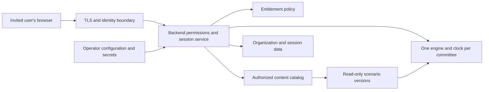

# Licensing-ready production architecture

Status: future commercial target design, updated 2026-09-17. The current GitHub release remains free to download under its existing GPLv3 license. The local Windows private-beta packaging workflow, runtime configuration, diagnostics, readiness, and backup boundaries are implemented; authentication, entitlement enforcement, managed hosting, and the physical source-directory migration remain future work. Read with the [private-beta ADR](adr-0001-private-beta-runtime.md), [file map](repository-file-map.md), [migration plan](commercial-migration-plan.md), and [license risk report](../commercial/license-ip-risk-report.md).

## 1. Product decision

Preserve the existing Python engine, Flask backend and browser UI as a private modular monolith. The first private-beta channel is a signed Windows installer for selected chairs, with one supervised local runtime and persistent customer-data directory. Testers receive neither the repository nor a Python setup. Vendor-managed hosting remains the preferred commercial model when the core must stay entirely on vendor infrastructure.

Use one product codebase for all organizations, varying configuration and scenario content. Add customer-required mechanics as general tested capabilities, not organization-specific engine branches.

Vendor-managed organization hosting is the first commercial deployment model. Customer-hosted delivery follows an explicit enterprise requirement and distribution-rights review. An installer can remove the need to edit source, but Python wheels/containers still contain inspectable code. Bundling or compilation cannot guarantee secrecy from the customer's administrator. If keeping core implementation off customer machines is mandatory, use vendor-controlled hosting.

## 2. Four separate boundaries

| Boundary | Contents | Management |
| --- | --- | --- |
| Engine/product | Core, backend, dashboard/editor assets, approved dependencies | Vendor release artifact; immutable during operation |
| Scenario content | Declarative JSON, maps, briefings, manifest, provenance/notices | Independently versioned artifact; read-only after installation |
| Configuration | Deployment identity, host/port, paths, authentication integration, map provider and entitlement policy | Operator-managed and validated; secrets supplied separately |
| Customer data | Checkpoints, records, drafts, exports, audit logs | Writable organization/session storage with access control and backups |



Core owns numerical behavior, doctrine, validation and serialization. Backend owns authorization, catalog resolution, lifecycle, storage locations and commercial policy. Core must not import billing/authentication services or make licensing requests during simulation ticks.

Use small service boundaries only as needed: `ScenarioCatalog.resolve(principal, package_id, version)`, `EntitlementService.authorize(principal, action, resource)`, a `SessionService` owning the engine/thread, and a `CheckpointStore` owning filesystem writes. Start with existing `package` and `storage_dir` injection before adding abstractions.

## 3. Runtime and access

The existing `server.py` module-global engine and timeline thread make ordinary multi-worker deployment unsafe. Different workers would own independent state. Use one application process per committee; add more isolated processes/containers for more committees. Disable automatic replicas sharing one session volume until exclusive engine ownership is designed.

A production WSGI server such as Waitress is a Windows-compatible starting point. Its single-process/multithreaded model still needs engine locks and serialized mutations; see [Flask's Waitress guidance](https://flask.palletsprojects.com/en/stable/deploying/waitress/). The supervisor owns startup/restart. Do not start active simulation threads at module import. Explicitly stop and join the clock during replacement/shutdown, and drain in-flight mutations before storage migration.

Invite named chair accounts for beta. Protect the whole application/API, including catalog, registry, editor, commands, saves, logs, exports and diagnostics. Add secure sessions, CSRF protection where cookie authentication is used, request limits and actor audit records. Derive organization membership from trusted identity/configuration, never an unchecked request field. If a proxy authenticates users, block direct backend access and trust identity headers only from that proxy.

Current state responses contain complete chair information. Delegate access requires server-side filtering of state, private briefings, logs, reports and caches. Hiding markers in browser code does not protect the underlying data.

## 4. Packaging

Start with one root `pyproject.toml` and one internal product distribution containing uniquely named `cdc_sim_core` and `cdc_sim_backend` packages. Explicitly map packages from the business directories. Stage frontend/editor assets into installed backend package resources during the build; test resource resolution independently of the source working directory.

| Artifact | Included | Excluded |
| --- | --- | --- |
| Private runtime wheel/container | Product code, approved browser assets, runtime libraries, entry point, notices | Customer payloads, saves, secrets, Git history, developer environment |
| Authoring distribution/profile | Scenario editor and DEM tooling with authoring dependencies | Other customers' material and vendor signing keys |
| Scenario archive | Manifest, existing five JSON payloads, approved GIS/media, provenance and notices | Executable plugins, server configuration, credentials, session data |
| Release records | Source revision, hashes, compatibility, SBOM, notices and required source-access materials | Secrets and private customer records |

Keep the internal wheel/container private. Browser JavaScript remains inspectable and must contain no vendor secret or trusted license enforcement.

Preserve dependencies initially. Requests and Matplotlib are directly used by `dem_scanner.py` and can later become authoring extras, but update `/api/health` first because it currently treats all six direct dependencies as mandatory. Rasterio still depends on certifi, so moving the downloader does not remove that obligation. Do not delete native libraries by filename without proving the remaining GIS behavior works.

For containers, use an explicit build-context allowlist, read-only application filesystem and non-root execution where supported. Audit the Linux image independently from the inspected Windows environment. Suggested installed layout:

```text
<install-root>/releases/<product-version>/       immutable application
<config-root>/deployment.json                  operator settings
<content-root>/<package-id>/<version>/         immutable authorized packs
<data-root>/<organization-id>/<session-id>/
    checkpoints/
    logs/
    exports/
<data-root>/<organization-id>/drafts/          unpublished authoring
```

Mount content/configuration read-only and session data read-write. Permissions and server authorization enforce isolation; directory names alone do not. Keep keys out of source/scenarios and configure map providers without a code release.

## 5. Production build workflow

The Windows beta workflow under `deployment/windows` implements local source policy checks, PyInstaller assembly, artifact validation, build metadata, hashing, signing gates, and Inno Setup packaging. Move the same reviewed steps into private CI before distribution. The broader wheel/container pipeline below remains the target after the path/package migration.

| Step | Work | Gate/output |
| --- | --- | --- |
| 1. Select source | Protected release tag tied to a reviewed immutable commit and release profile | Source revision and approved distribution policy |
| 2. Resolve inputs | Pin Python, OS/base image, build tools, full dependency graph and browser assets; lock hashes per platform | Reproducible inputs without floating transitive/CDN versions |
| 3. Verify source | Existing regressions, synthetic scenario validation, import boundaries, migration/access tests as implemented | Passing checks without intentionally excluded customer content |
| 4. Assemble | Build internal wheel, install into clean runtime/image, include declared resources and dependencies | Installed artifact runs without repository checkout |
| 5. Inspect artifact | Audit actual native binaries/fonts, credentials/customer-file exclusions, licenses and content rights | Artifact-specific SBOM, notices/source-access bundle; unresolved distribution blockers closed |
| 6. Exercise artifact | Production startup, login, mount, pause/run, commands, checkpoint/restore, reports, shutdown, supported GIS behavior | Acceptance evidence and exactly one clock per committee |
| 7. Identify/sign | Hash artifacts and sign release manifest using vendor-controlled keys | Binding of product version, source revision, artifact digest and compatibility |
| 8. Publish privately | Push immutable artifact to private registry/download storage | Access limited to operators or entitled installations |
| 9. Promote | Deploy the same digest through staging, beta and stable | Tested artifact equals deployed artifact |

After build metadata and locks exist, the conventional wheel step is `python -m build --wheel`; a hashed runtime installation uses `python -m pip install --require-hashes -r requirements-runtime.lock`. These are proposed steps, not currently runnable production instructions. See [PyPA packaging](https://packaging.python.org/en/latest/tutorials/packaging-projects/) and [pip secure installation](https://pip.pypa.io/en/stable/topics/secure-installs/).

Fail immediately on installation/test errors and preserve diagnostics. Customers should launch a provisioned runtime, not recreate a virtual environment or install from the internet on each run. Keep the Windows root launchers as compatibility entry points during migration.

## 6. Versioning

Use one semantic product version initially, with prereleases such as `1.0.0-beta.1` as an example, not a declaration of the current release. Avoid separate releases for every internal directory.

| Identifier | Purpose |
| --- | --- |
| Product version and artifact digest | Exact engine/backend/UI release |
| Rules schema | Content structure; current value 1 |
| Simulation rules revision | Changes in rule interpretation/numerical semantics even if JSON structure is unchanged |
| Package manifest schema | New commercial content envelope, independently versioned |
| Scenario ID, version and digest | Immutable content/GIS revision |
| Save format | Current writer 4; readers accept 1–4 |
| External API version | Introduce when supporting an external contract; retain current URLs during moves |

Do not bump save format merely for folder moves. When adding restore-critical fields, evolve it explicitly and test older saves. New saves should bind product/rules revision, scenario ID/version/digest, session identity, and any introduced engine-owned random state. Current saves do not contain all these fields; exact replay is not established.

Publish supported engine/rules versions in each pack manifest. Existing sessions retain original package versions. Schema compatibility alone does not promise identical adjudication when coefficients or algorithms change.

## 7. Licensing and content control

Keep the current payload and validated loader. A new manifest records stable ID, publisher, immutable version, compatible engine/rules versions, file hashes, provenance and attribution references. Validate archives before activation: path containment, symlinks, duplicate entries, expansion limits, allowed file types, schema and references. Never execute scenario-provided code. Keep customer drafts separate from installed packs.

Entitlements are server-controlled. Customer-authored `paid`, `license`, or `organization_id` fields cannot grant permission. Authorize catalog listing, installation, downloading/exporting, mounting and session creation. A signature proves package origin/integrity, not ownership of included assets or entitlement to use the product.

Beta can use operator-managed grants for organizations, packs and features. Add billing only when needed. Later offline grants may include organization/installation identity, permitted packs/features, validity and key ID; vendor infrastructure holds private signing keys and installations hold verification keys.

Define renewal, revocation, clock behavior and bounded grace rules. Offline revocation cannot take effect until reconnection or expiry, and a host administrator can tamper with local enforcement. Preserve access to existing checkpoints/exports and communicate expiry before new sessions. A license failure must not delete customer data or change combat outcomes.

## 8. Updates and rollback

Use operator-controlled updates between committee sessions during beta. Updating the application and changing entitlements are separate operations.

1. Download to staging; verify the signed release/digest and compatibility before changing the installation.
2. Pause the timeline, drain mutations, make a verified checkpoint, and back up data/configuration with exact package references.
3. Test migrations against a copy. Retain the previous runtime and original immutable scenario versions.
4. Stop the old engine owner, switch the application release, and start the new process with isolated data/configuration mounts.
5. Verify authentication, mounting, restore, reports and the single-clock invariant; resume when ready.
6. On failure, stop the new owner and restore both the previous runtime and its compatible data snapshot. Image rollback alone does not undo save migration.

Never run two timelines for one committee during cutover. Keep the familiar three checkpoints and pause-on-restore behavior; operational backups supplement them. Do not update a session's scenario silently as part of an application upgrade.

## 9. Deployment models

| Model | Experience | Source/isolation implications | Sequence |
| --- | --- | --- | --- |
| Signed local Windows beta | Invited chair installs and launches one app | Ordinary source files are excluded; host administrators can still inspect/reverse engineer packaged code | Current beta |
| Vendor-hosted beta | Invited chair opens a URL | Core stays on vendor infrastructure; isolated process/volume | Later beta option |
| Vendor-managed organization | Organization URL, roles, content, backups/support | Same image with separate organization configuration/data | First commercial offer |
| Customer infrastructure | Operator installs approved runtime | Administrator can inspect artifacts; native-library/distribution gates apply | After enterprise demand |
| Offline installation | Supported service/installer, local browser, signed grant, curated maps | Customer controls host; bounded enforcement and licensed offline assets required | Later |

The first implementation slice is explicit content/data paths and core packaging, followed by an authenticated supervised beta. Preserve simulation behavior through the migration. This design does not change the existing license, publish source, or deploy the service.
